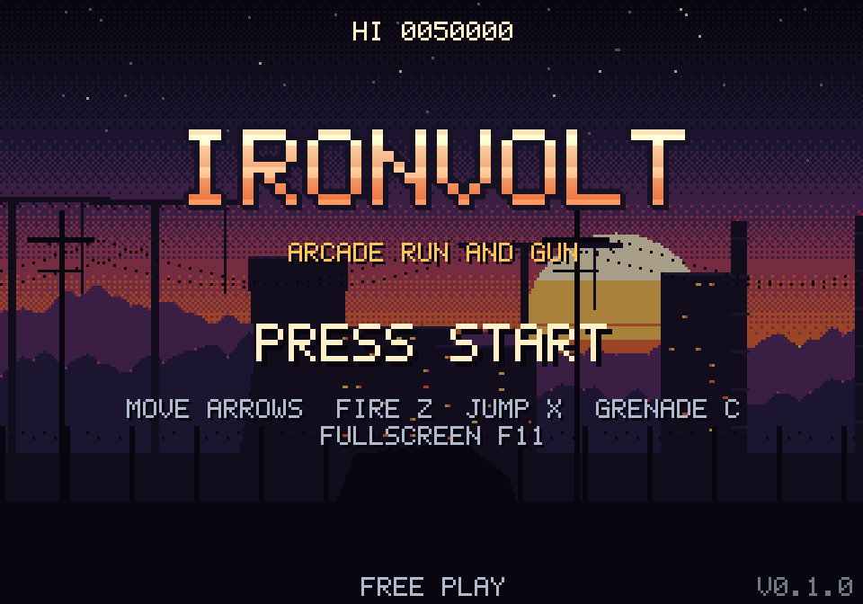
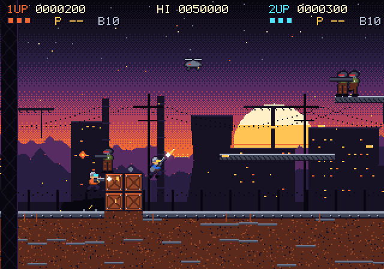
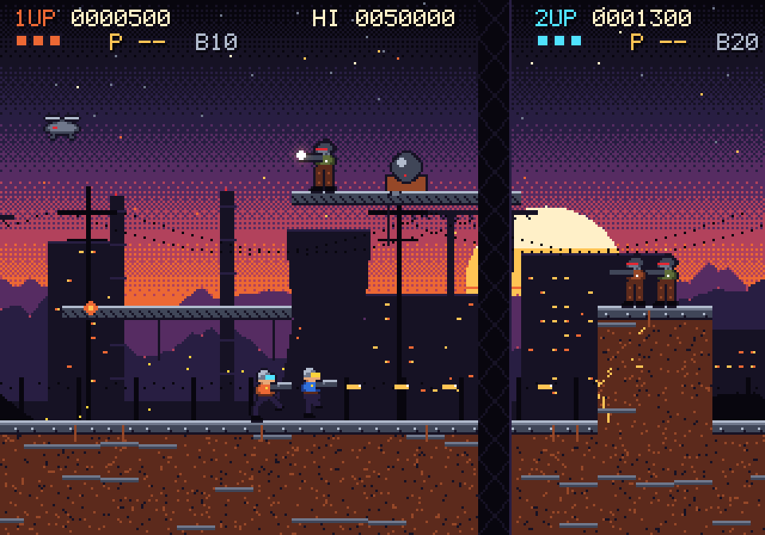
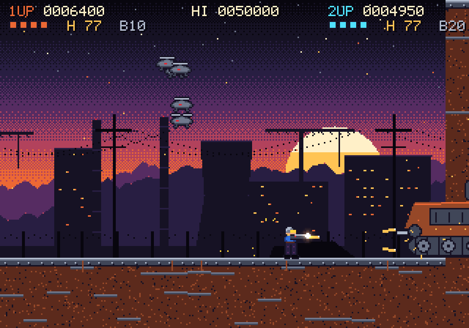
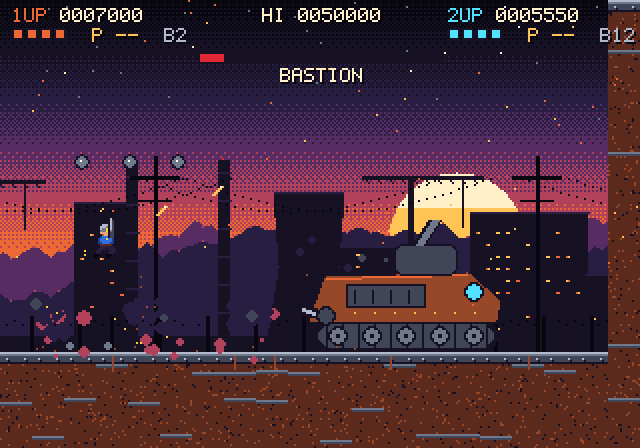

<div align="center">



# IRONVOLT

**Two soldiers. One endless dusk. Every bullet counts.**

A 90s-arcade run-and-gun for one or two players: chunky pixels, screen-shaking explosions,
a tank boss with a second phase, and not a single image or sound file in the repo.
**Every pixel and every note is made by code.**




[](https://github.com/makavli/ironvolt/releases/latest/download/Ironvolt.exe)
[](https://github.com/makavli/ironvolt/releases/latest/download/Ironvolt-macos.zip)
[](https://github.com/makavli/ironvolt/releases/latest/download/Ironvolt-linux.tar.gz)

</div>

**Windows:** double-click `Ironvolt.exe`. It is not code-signed, so the first time Windows says "Windows protected your
PC": click **More info**, then **Run anyway**. **macOS:** unzip, then right-click `Ironvolt.app` and choose **Open**
the first time. **Linux:** unpack and run `Ironvolt/Ironvolt`.

## The Long Dusk

In 2079 the Voltline grid burned in a single night, and the sun has not cleared the horizon since. The **Rust
Legion** holds the last working tower and drags grid technicians from their towns in chains to keep it running.

You are what is left of the **Ironvolt Brigade**, the crews who used to climb those towers. Free every technician
you reach. Break the Legion's gate. Turn the lights back on. *([The full story](docs/STORY.md))*

## What's in the cabinet

| | |
|---|---|
|  |  |
| **8-way aim, run, jump, drop through catwalks.** Troopers, grenadiers, drones and turrets come from every side. | **Free the prisoners, take their guns:** heavy gun, spread, rockets, grenades, extra lives. |

<div align="center">



**BASTION**, the Legion's gate crawler. Two phases. Bring grenades.

</div>

- **Two players on one machine**, keyboard or any gamepad (Xbox, PlayStation, Switch Pro), with rumble and light bar.
- **Smooth on any screen:** logic at a fixed 60 Hz, drawn blended at your refresh rate (144 Hz, 165 Hz...), scaled
  up in sharp whole steps inside a cabinet bezel (or to fit the window). Optional scanlines. Sharp on high-DPI
  screens too.
- **Arcade to the bone:** hit-stop, screen shake, a kill-chain multiplier up to x8, continues, coins or free
  play, and a high-score table.
- **Easy, Normal or Hard**, chosen before every game. Die too often and the game asks if you are too feeble.
- **Options for everyone:** lives, music and effects volume, rumble, swapped fire and jump, screen shake, flashes
  and a slower game speed, all saved. A controls page shows the keys and the pad.
- **A synthesized stereo soundtrack:** a title theme, a stage theme and a boss theme that crossfades in when the
  gate locks.
- **Zero asset files:** sprites, tiles, the font, every sound effect and the music are generated at start-up.

## Play from the source

```bash
python -m venv .venv
.venv/Scripts/python -m pip install -r requirements.txt   # macOS/Linux: .venv/bin/python
.venv/Scripts/python run.py
```

| | Player 1 | Player 2 | Gamepad |
|---|---|---|---|
| Move / aim | Arrows | WASD | Stick or D-pad |
| Fire | Z | G | X or RT |
| Jump | X | H | A |
| Grenade | C | J | B or RB |
| Start / join / pause | Enter or 1 | 2 | Start |

Down + jump drops through a catwalk. Up, diagonals, and down in the air aim your shot.
Coin: 5 (or Back) when free play is off. F11 or Alt+Enter: fullscreen. F2: scanlines. F3: free play on/off.
Esc: pause (or back out of a menu). The pause menu has the options and the way back to the title.

Free the prisoners: each one drops a weapon (H heavy gun, S spread, R rockets, B grenades, 1 extra life).

## Develop

`bash tools/test_local.sh` runs every check on your machine: unit tests, a bot that plays the stage to the end,
screenshots in `shots/`, and a real window for a few seconds. `--exe` also builds `Ironvolt.exe`; `--web` builds
the browser version and plays it in headless Chrome (`bash tools/web_build.sh --serve` to play it yourself).

`python tools/media.py` re-records the GIFs and pictures in this README (needs ffmpeg).

## Licence

Source available, all rights reserved: see [LICENSE](LICENSE). Credits: [CREDITS.md](CREDITS.md).
